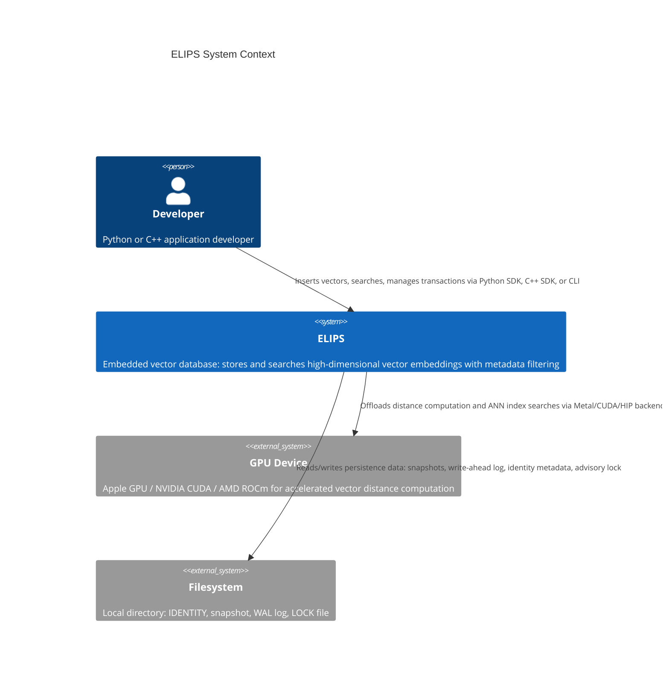
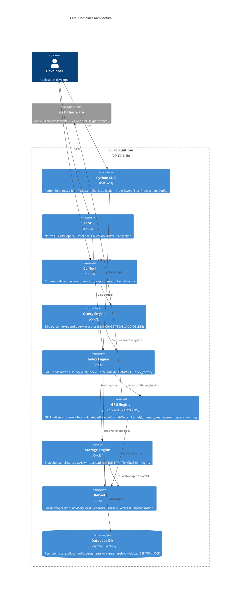

# ELIPS System Architecture

ELIPS is an embedded local vector database implemented in C++23 with Python and C++ SDKs, GPU acceleration, and single-writer/multi-reader concurrency via advisory file locks. This document describes the high-level system architecture.

## C4 Context Diagram



## Container Diagram



## Layered Architecture

ELIPS follows a clean layered architecture with five logical tiers:

```
+-------------------------------------------------------------+
|  API Layer (CLI, Python SDK, C++ SDK)                       |
|  - CLI: command-line tool (elips)                           |
|  - Python: PyBind11 bindings (elips._core)                  |
|    Chroma-style Client/PersistentClient + Collection,       |
|    plus the FAISS Index layer                               |
|  - C++: Direct C++ API (open(), Database, Collection)       |
+-------------------------------------------------------------+
|  Query Engine Layer                                         |
|  - EQL Parser + Lexer (recursive descent)                   |
|  - Query Executor (Statement → SearchResult via std::visit) |
|  - AST: SearchStatement, GetStatement, ScanStatement,       |
|    AddStatement, DeleteStatement                            |
+-------------------------------------------------------------+
|  Index Engine Layer (FAISS-recognizable)                    |
|  - Index (abstract base, Dependency Inversion)              |
|  - IndexFlat (brute-force, ground truth for benchmarks)     |
|  - IndexHNSW (HNSW, primary ANN index)                      |
|  - IndexIVFFlat / IndexIVFPQ / IndexIVFScalarQuantizer      |
|  - index_factory ("IVF4096,PQ16" string constructor)        |
+-------------------------------------------------------------+
|  Storage Engine Layer                                       |
|  - WAL: write-ahead log (CRC32C-validated, append-only)     |
|  - Snapshot / segments: serialization, atomic rename        |
|  - IDENTITY file: dimension, metric, index type             |
|  - LockManager: flock(LOCK_EX|LOCK_NB) advisory lock        |
+-------------------------------------------------------------+
|  GPU Engine Layer (optional, compile-time backend)          |
|  - GpuBackend (abstract backend interface)                  |
|  - Backends: Metal (validated), CUDA/HIP (experimental)     |
|  - Indices: GpuGraphIndex, GpuBruteForce, GpuIVFFlat,       |
|    GpuIVFPQ, GpuHybridIndex; standalone bf_knn              |
|  - Memory: GpuMemoryManager (best-fit pool), unified        |
|  - Batching: QueryBatcher (time-window + max-batch)         |
|  - Selection: GpuDeviceManager + BackendSelector            |
+-------------------------------------------------------------+
```

### Layer Descriptions

#### 1. API Layer
The outermost layer provides three entry points to the system:
- **C++ SDK**: Direct usage of `elips::open()`, `elips::Database`,
  `elips::Collection`, `elips::Transaction`, plus the `Index` layer. The
  `Database` class (formerly `ElipsInstance`) owns all collections and the WAL.
  Headers are in `include/elips/`.
- **Python SDK**: PyBind11 bindings in `bindings/python/elips_python.cpp` expose
  the C++ classes. The Chroma-style surface is `Client()` /
  `PersistentClient(path=)` → `Collection`; the FAISS Index layer
  (`IndexFlat`/`IndexIVFFlat`/`index_factory`/`bf_knn`) is exposed directly.
  Uses `TransactionHolder` to keep the Python handle alive during transaction
  lifetime.
- **CLI Tool**: A standalone executable (`elips_cli` → `elips`) at
  `cli/src/main.cpp` supporting commands: `info`, `collections`, `query`,
  `checkpoint`, `export`, `import`, `verify`, `stats`, `bench`.

#### 2. Query Engine Layer
The EQL (ELIPS Query Language) engine provides a SQL-like query interface:
- **Lexer** (`EQLLexer`): Tokenizes EQL source into `Token` objects (kind: word, number, string, punct, end).
- **Parser** (`EQLParser`): Recursive-descent parser producing an AST as `Statement` variant (SearchStatement, GetStatement, ScanStatement, AddStatement, DeleteStatement).
- **Executor** (`QueryExecutor`): Uses `std::visit` over the statement variant, delegating to `Database::collection()` operations. Supports vector bindings (`$name`), threshold filtering, rank-by metadata field ordering, and field projection.

#### 3. Index Engine Layer
Implements vector similarity search with a FAISS-recognizable, pluggable Index API:
- **Index**: Pure virtual base (formerly `IndexPort`) defining the FAISS contract — `train()`, `add()`, `add_with_ids()`, `search()`, `range_search()`, `reconstruct()`, `remove()`, `reset()`, `is_trained()`, `ntotal()`, `d()`, `metric_type()`. All callers depend only on this interface (Dependency Inversion Principle).
- **IndexFlat**: Brute-force linear scan over row-major float arrays (formerly `ExactIndex`). Returns exact top-k. Used for small collections and as the ground-truth oracle for ANN benchmarks.
- **IndexHNSW** (formerly `HierarchicalGraphIndex`): Primary ANN index. Multi-layer directed graph with probabilistic level assignment (`mL = 1/ln(M)`), beam search, and diversity-based neighbor selection. Removals are soft tombstones. Tuned via `HnswParams`.
- **IVF family**: `IndexIVFFlat`, `IndexIVFPQ`, `IndexIVFScalarQuantizer`, composed from `KMeans` / `ProductQuantizer` / `ScalarQuantizer`.
- **index_factory**: Parses a FAISS-style string (e.g. `"IVF4096,PQ16"`) into the concrete `Index` (replaces the old fluent `IndexFactory` / `make_index`).

#### 4. Storage Engine Layer
Provides persistence and crash safety:
- **WAL** (Write-Ahead Log): Located at `wal.log` in the database directory. Every insert/erase is appended (with CRC32C checksum) to the log BEFORE the in-memory mutation. Configured sync behavior via `Durability`: `paranoid` (flush every record), `standard` (flush every record, group-commit deferred), `relaxed` (buffered, flushed on checkpoint/close), `ephemeral` (no WAL).
- **Snapshot**: Full database serialization to `elips.snapshot`. Written to a temp file first, then atomically renamed over the live snapshot (`fs::rename`). After a successful snapshot, the WAL is truncated (`WAL::reset()`).
- **IDENTITY**: Binary file recording the dimension, metric, and index type. Validated on open to prevent configuration conflicts.
- **LockManager**: RAII advisory file lock on the `LOCK` file using POSIX `flock(LOCK_EX | LOCK_NB)`. Enforces the single-writer / multi-reader contract across processes.

#### 5. GPU Engine Layer
Optional layer for GPU-accelerated vector operations (see the
[GPU guide](../gpu/index.md) for the maturity table and troubleshooting):
- **GpuBackend** (formerly `GpuPort`): Abstract interface for device management, memory allocation, data transfer, distance computation, GPU top-k, GPU IVF scan, and synchronization.
- **Three backends**: Metal (Apple, **validated on Apple M4**), CUDA (NVIDIA, **experimental, not hardware-validated**), HIP (AMD, **experimental, not hardware-validated**).
- **GpuDeviceManager**: Probes all compile-time-enabled backends and reports device info; **BackendSelector** (formerly `GpuSelector`) orders candidates and selects one per `GpuPolicy`. Device selection is explicit (`device="cpu|metal|cuda:N|hip:N|auto"`) and CPU fallback is **never silent** — a named-but-absent backend raises `BackendUnavailableError` unless `fallback=True`, which logs a warning to stderr.
- **GPU Indices**: GpuGraphIndex, GpuBruteForceIndex, GpuIVFFlatIndex, GpuIVFPQIndex, GpuHybridIndex (GPU + CPU fallback), plus standalone `bf_knn` (exact k-NN, no index build).
- **Metal kernels** (real, loaded from `elips_kernels.metallib`): tiled-GEMM distance (`elips_l2_matrix` / `elips_ip_matrix`), GPU top-k (`topk_select`), and two-pass GPU IVF scan (`elips_ivf_scan_list` + `elips_ivf_merge_lists`). Adapted from upstream FAISS `gpu_metal`.
- **Memory**: GpuMemoryManager (best-fit pool allocator, thread-safe), GpuMemoryPool, pinned memory, unified-memory auto-detection on Apple Silicon (`MTLResourceStorageModeShared` → zero-copy `memcpy`).
- **Batching**: QueryBatcher (formerly `DynamicBatcher`; push model, worker thread, time-window + max-batch coalescing, `std::future` results).
- **Pipelines/Profiling**: GpuSearchPipeline, GpuQuantizationPipeline, GpuIngestionPipeline; GpuProfiler records kernel timing.

### Cross-Cutting Concerns

- **Error Handling**: All errors derive from `elips::ElipsError` (inherits `std::runtime_error`). Subclasses: `DimensionMismatch`, `InvalidVector`, `ConfigError`, `NotFound`, `StorageError`, `LockConflict`, `ParseError` (EQL).
- **Durability Levels**: `paranoid` (flush WAL every record), `standard` (flush WAL every record, group-commit future), `relaxed` (WAL buffered), `ephemeral` (no WAL, in-memory only).
- **In-Memory Mode**: Pass `":memory:"` as the path to `open()`. No persistence, no WAL, no lock. Requires explicit dimension.
- **Collections**: Named partitions of records within a database (formerly "Vaults"). Each `Collection` owns its own `Index` and record store, and is built on top of that Index. Created lazily on first access via `Database::collection(name)`.

### Key Design Decisions

| Decision | Rationale |
|----------|-----------|
| C++23 standard | `std::expected`, `std::span`, `std::variant`, concepts support |
| Single-writer model | Advisory file lock + single-threaded WAL simplifies ACID semantics |
| UUIDv7 RecordID | Time-ordered (lexicographic byte order = insertion order), 128-bit |
| Pluggable indices (DIP) | `Index` interface enables swapping IndexFlat/IndexHNSW/IVF/GPU indices without changing callers |
| WAL-before-memory | Mutations are durably recorded before in-memory state changes |
| Atomic snapshot publish | Write to temp file, `fs::rename` over live snapshot (POSIX atomic rename) |
| Best-fit pool allocator | GPU memory pool minimizes fragmentation with block coalescing on free |
| Compile-time backend detection | `#if defined(ELIPS_METAL_ENABLED)` etc. — no runtime dispatch overhead for disabled backends |
| PyBind11 bindings | Direct C++ exposure, zero-copy where possible, RAII lifetime management via `TransactionHolder` |